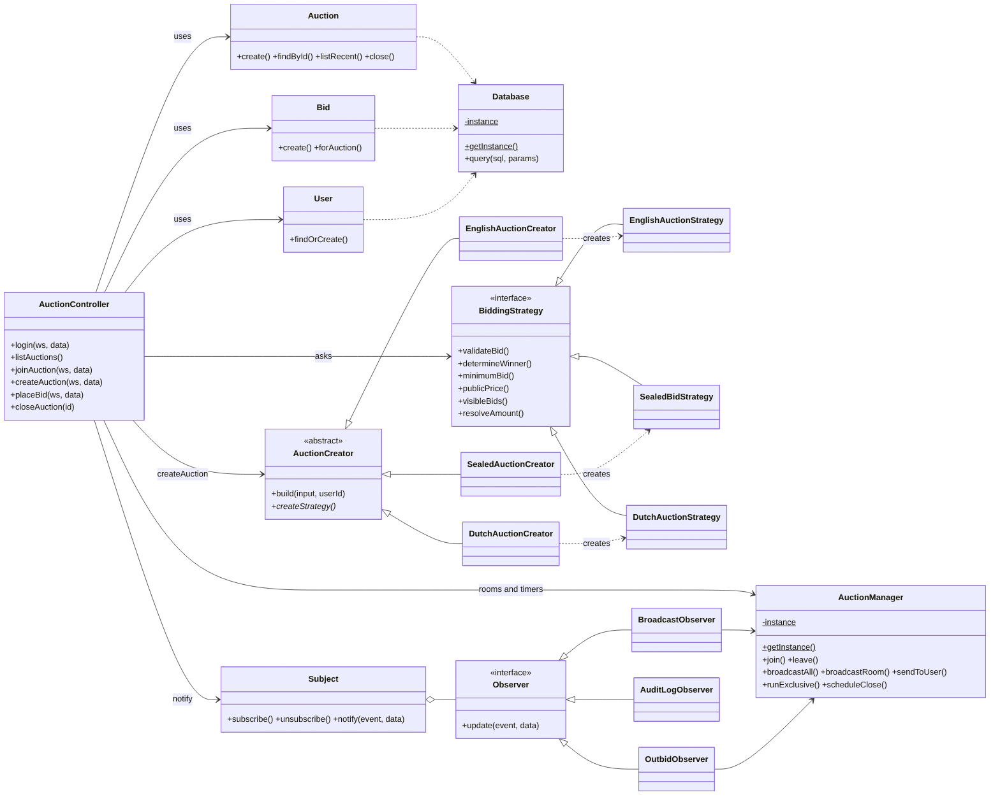
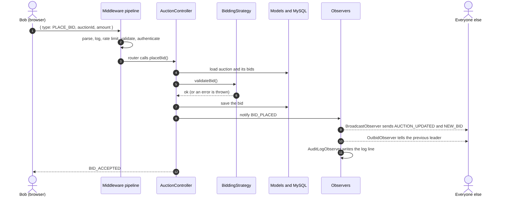

# Going once: a live auction

A real-time auction app. People join an auction room, bid against each other, and every screen updates instantly. When the timer ends, the server picks the winner.

Built with **Node.js**, **WebSockets**, **MySQL**, plain **HTML/CSS/JavaScript**.
Course: *Architectures logicielles et Middleware*. It uses an **MVC** architecture, the **Singleton**, **Strategy**, **Observer** and **Factory Method** design patterns, and a **WebSocket middleware** pipeline.

## Run it

You need **Node.js 20+** and a **MySQL** server (XAMPP, MySQL Workbench or MariaDB all work).

```bash
npm install
cp .env.example .env        # Windows: copy .env.example .env
# open .env and set DB_USER / DB_PASSWORD for your MySQL (XAMPP default: root and an empty password)
npm run db:init             # creates the database and the 3 tables (safe to re-run: it upgrades an older database without deleting data)
npm start                   # then open http://localhost:3000
```

To bid against yourself, open **two or three browser tabs** and join with a different name in each (the name is remembered per tab).

## Where each requirement is met

| Requirement | Where | What it does here |
|---|---|---|
| **MVC** | `src/models/`, `src/views/` + `public/`, `src/controllers/` | Models talk to MySQL only. The controller holds the rules. The view is what the browser draws. |
| **Singleton** | `src/patterns/singleton/Database.js` | One shared MySQL connection pool. |
| **Singleton** | `src/patterns/singleton/AuctionManager.js` | The one place that knows who is connected, who is in which room, and which closing timers run. |
| **Strategy** | `src/patterns/strategy/` | `EnglishAuctionStrategy`, `SealedBidStrategy` and `DutchAuctionStrategy` decide how bids are validated, who wins, and what each person may see. |
| **Factory Method** | `src/patterns/factory/` | `AuctionCreator` defines the factory method `createStrategy()`. Each subclass (`EnglishAuctionCreator`, `SealedAuctionCreator`, `DutchAuctionCreator`) builds its own strategy and its own database record. |
| **Observer** | `src/patterns/observer/` | The controller announces `BID_PLACED`; three observers react independently. |
| **WebSocket middleware** | `src/middleware/` | Every message goes through a 7-step pipeline before it reaches the controller. |

### Singleton
`Database.getInstance()` and `AuctionManager.getInstance()` always return the same object, and `new` on them throws. If two parts of the app each had their own manager, they could disagree about who is in a room.

### Strategy
The controller never asks "is this an English auction?". It asks the strategy: `validateBid()`, `determineWinner()`, `visibleBids()`, `publicPrice()`. To add a new auction type, write one new class (see the end of this file). The controller does not change.

| | English | Sealed bid | Dutch |
|---|---|---|---|
| Bids visible | Everyone, live | Only your own, until the end | Everyone (there is only one) |
| Rule | Beat the highest bid by the minimum raise | One secret bid, at least the starting price | The price falls in a straight line to a lowest price. Accept it to buy. |
| Winner | Highest bid | Highest bid (earliest wins a tie) | The first buyer, who pays the server's price at that moment. The auction ends at once. |
| If nobody bids | No winner | No winner | Unsold at the lowest price |

The Dutch price is never stored. The server computes it from the clock (`dutchPrice()`), and the browser uses a copy of the same formula (`public/js/pricing.mjs`) to animate it. `test/pricing.test.js` checks that both copies always agree. The server stays the judge: if a buyer's screen shows a lower price than the server's, the buy is refused with `PRICE_CHANGED`.

### Factory Method
The controller never writes `new EnglishAuctionStrategy()` or builds a database record by hand. It asks `getCreator(type).build(input, userId)`.

```
AuctionCreator              build() is the template: validate, then createStrategy(), then build the record
 ├─ EnglishAuctionCreator   createStrategy() returns an EnglishAuctionStrategy (keeps the minimum raise)
 ├─ SealedAuctionCreator    createStrategy() returns a SealedBidStrategy
 └─ DutchAuctionCreator     createStrategy() returns a DutchAuctionStrategy (also checks the lowest price)
```

Strategy answers "how does this auction behave?". Factory Method answers "who creates the right objects for this type?". Together, a new auction type is one strategy class plus one creator class.

### Observer
`Subject` (the publisher) notifies its observers. The controller does not know who is listening.

| Observer | Reacts to a bid by |
|---|---|
| `BroadcastObserver` | Pushing the new price to every screen and the bid to the room |
| `OutbidObserver` | Privately telling the previous leader they were outbid |
| `AuditLogObserver` | Writing a line to the console and to `logs/audit.log` |

### WebSocket middleware
A middleware is a function `(ctx, next)`: it does its job, then calls `next()` to pass the message on, or throws to stop it. `src/middleware/index.js` lists the pipeline in order:

```
raw text ─▶ errorHandler ─▶ parse ─▶ logger ─▶ rateLimit ─▶ validate ─▶ authenticate ─▶ router ─▶ controller
```

| Step | Job |
|---|---|
| `errorHandler` | Catches any error below and sends it to the user as an `ERROR` message. |
| `parse` | Text to `{ type, payload }`; rejects malformed messages. |
| `logger` | Logs each message and its duration (code after `next()` runs on the way back). |
| `rateLimit` | Max 20 messages per 5 seconds per connection. |
| `validate` | Checks and cleans every field. After this, the controller can trust its input. |
| `authenticate` | Everything except `LOGIN` needs a logged-in connection. |
| `router` | Maps `type` to a controller method. No business logic. |

## Architecture



What happens when someone bids:



## Folder structure

```
src/
  server.js                  wires everything together and starts the server
  config/env.js              reads .env
  models/                    User, Auction, Bid          (MODEL: SQL only)
  views/auctionView.js       what the browser may see    (VIEW, server side)
  controllers/               AuctionController           (CONTROLLER: the rules)
  middleware/                the 7-step pipeline
  patterns/
    singleton/               Database, AuctionManager
    strategy/                BiddingStrategy, English, Sealed, Dutch
    factory/                 AuctionCreator + one creator per auction type
    observer/                Subject, Observer, Broadcast, Outbid, AuditLog
  websocket/messages.js      the { type, payload } format
public/                      index.html, css/, js/       (VIEW, browser side)
sql/schema.sql               the 3 tables
test/                        unit tests (no database needed)
scripts/                     db:init and the end-to-end smoke test
docs/                        UML diagrams (.mmd sources + .png)
```

## Message protocol

Every message is JSON: `{ "type": "...", "payload": { ... } }`.

| Browser to server | Payload |
|---|---|
| `LOGIN` | `username` |
| `LIST_AUCTIONS` | |
| `CREATE_AUCTION` | `title`, `description?`, `strategy` (`english`, `sealed` or `dutch`), `startPrice`, `minIncrement?` (English), `floorPrice` (Dutch, below `startPrice`), `durationSeconds` (30 to 86400) |
| `JOIN_AUCTION` / `LEAVE_AUCTION` | `auctionId` / nothing |
| `PLACE_BID` | `auctionId`, `amount` |

| Server to browser | Sent to | Meaning |
|---|---|---|
| `LOGGED_IN`, `AUCTION_LIST`, `AUCTION_STATE`, `AUCTION_CREATED_OK`, `BID_ACCEPTED` | the sender | Replies |
| `AUCTION_UPDATED` | everyone | An auction changed (new price, new bid count, ended) |
| `NEW_BID` | the room | A new bid in an open-bid auction (never sent for sealed bids) |
| `OUTBID` | the previous leader | "Somebody beat your bid" |
| `AUCTION_ENDED` | the room | Result, with all bids revealed |
| `ERROR` | the sender | `{ code, message }`, for example `BID_TOO_LOW` |

## Five-minute demo

1. Open three tabs. Join as `Taher`, `Amal`, `Youssef`.
2. As Taher, click **New auction**: "Vintage bicycle", English, start 200, raise 25, 2 minutes.
3. As Amal, join the lot and bid 200. Watch Taher's and Youssef's screens update at once.
4. As Youssef, click **Bid 225 MAD**. Amal gets an *outbid* notification.
5. Create a **Sealed bid** auction. Bid from two tabs: nobody sees the other's amount. When it ends, all bids are revealed.
6. Create a **Dutch** auction (highest 800, lowest 100, 1 minute). Watch the price fall on every screen, then click **Buy now** in one tab. The auction ends at once and the other tabs see the winner.
7. Show `logs/audit.log` (Observer) and the terminal (middleware logger).

## Tests

```bash
npm test          # 70 unit tests: strategies, factory, observers, middleware, singleton. No database needed.
npm start         # in one terminal...
npm run smoke     # ...and in another: 32 end-to-end checks with real WebSocket clients (about 35 s)
```

The smoke test includes a **race condition** check: two people bid the same amount at the same instant, and exactly one bid must win.

## Design decisions

- **The current price is never stored.** It is computed from the bids (English, sealed) or from the clock (Dutch), so it can never disagree with them.
- **Bids on one auction run one at a time** (`AuctionManager.runExclusive`). Without this, two simultaneous bids can both be checked against the same old price and both accepted. The smoke test fails if you remove it.
- **Secrecy is enforced on the server.** A sealed bid is never sent to the wrong browser; the UI does not "hide" anything.
- **The server owns the clock.** The browser counts down locally from the server's end time, adjusted by the server's clock, so there is no need to send a tick every second.
- **Closing timers survive a restart.** On startup the server reads the open auctions and re-arms their timers.
- **The browser never uses `innerHTML` with user text**, so a name like `<script>` cannot inject anything.
- **Login is just a name** (no password) on purpose: the module is about architecture, not authentication.
- Limits: one server process (rooms live in memory); amounts are whole numbers in MAD.

## Add a new auction type

The Dutch auction was added exactly this way, without touching the controller's logic:

1. Create `src/patterns/strategy/<Name>AuctionStrategy.js` extending `BiddingStrategy` (the rules).
2. Create `src/patterns/factory/<Name>AuctionCreator.js` extending `AuctionCreator` (its `createStrategy()`, and any extra validation or fields).
3. Register the creator in `src/patterns/factory/index.js`.
4. Add the name to the `strategy` ENUM in `sql/schema.sql` (and to `upgradeOlderDatabase()` in `scripts/init-db.js`), and one more tile in the dialog in `public/index.html`.

The middleware and the observers stay untouched. That is the point of Strategy and Factory Method together.
